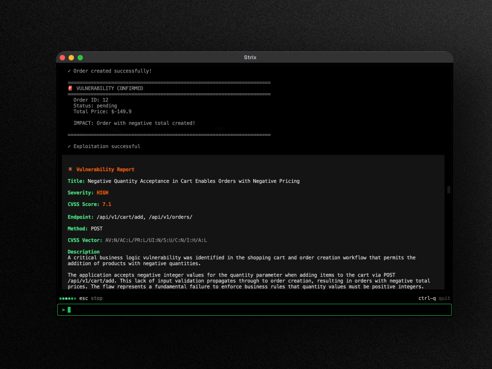

<div align="center">

# Baz

### Autonomous AI penetration-testing agents that find and validate vulnerabilities in your app.

<br/>

<a href="LICENSE"></a>

</div>

---


## Baz Overview

Baz are autonomous AI penetration testing agents that act just like real hackers - they run your code dynamically, find vulnerabilities, and validate them through actual proofs-of-concept. Built for developers and security teams who need fast, accurate security testing without the overhead of manual pentesting or the false positives of static analysis tools.

**Key Capabilities:**

- **Full pentesting toolkit** - reconnaissance, exploitation, and validation out of the box
- **Multi-agent orchestration** - teams of AI pentesters that collaborate and scale
- **Real exploit validation** - working PoCs, not false positives like legacy vulnerability scanners
- **Developer‑first CLI** - actionable findings with remediation guidance
- **Auto‑fix & reporting** - generate patches and compliance-ready pentest reports


<br>


<div align="center">
  <a href="https://baz.ai">
    
  </a>
</div>


## Use Cases

- **Application Security Testing** - Detect and validate critical vulnerabilities in your applications
- **Rapid Penetration Testing** - Get penetration tests done in hours, not weeks, with compliance reports
- **Bug Bounty Automation** - Automate bug bounty research and generate PoCs for faster reporting
- **CI/CD Integration** - Run tests in CI/CD to block vulnerabilities before reaching production

## 🚀 Quick Start

**Prerequisites:**
- Docker (running)
- An LLM API key from any [supported provider](https://docs.baz.ai/llm-providers/overview) (OpenAI, Anthropic, Google, etc.)

### Installation & First Scan

```bash
# Install Baz
curl -sSL https://baz.ai/install | bash

# Configure your AI provider
export BAZ_LLM="openrouter/z-ai/glm-5.3"
export LLM_API_KEY="your-api-key"

# Run your first security assessment
baz --target ./app-directory
```

> [!NOTE]
> First run automatically pulls the sandbox Docker image. Results are saved to `baz_runs/<run-name>`

### Updating

```bash
# Self-update the standalone binary to the latest release
baz --update

# ...or re-run the installer
curl -sSL https://baz.ai/install | bash
```

Installed with pipx, uv, or pip? `baz --update` prints the matching upgrade command instead (`pipx upgrade baz-agent`, `uv tool upgrade baz-agent`, `pip install --upgrade baz-agent`). Baz also shows a notice with the right command when a new version is available.

---

## Ways to Run Baz

- **Self-hosted** — run Baz locally with Docker and your own LLM key. [Quick Start](#-quick-start)
- **Hosted** — a managed deployment, for teams that would rather not run the
  sandbox themselves.

---

## What Baz produces

Every finding ships with a reproduction and the evidence behind it:

- **Validated findings with PoCs** — a working proof-of-concept and reproduction
  steps, not a scanner signature
- **Evidence bundles** — request/response, screenshots, console output, and a
  timeline, written per finding
- **A reproduction gate** — findings are re-run in a fresh sandbox before they
  are reported
- **Submission-ready exports** — HackerOne, Immunefi, and a triager package

---

## 🤖 Use Baz from Your Coding Agent

Baz is agent-ready. Give Claude Code, Cursor, Codex, or any [SKILL.md-compatible](https://agentskills.io) agent the ability to run pentests, fix findings, and set up CI scanning:

```bash
npx skills add usebaz/baz
```

This installs nine skills for running pentests, fixing findings, and CI scanning, against code, web apps, APIs, and the OWASP Top 10. Agents can use the local CLI or the managed cloud with the same engine.

See [`AGENTS.md`](AGENTS.md) for the quick reference, [docs.baz.ai/llms.txt](https://docs.baz.ai/llms.txt) for the CLI, and [docs.app.baz.ai](https://docs.app.baz.ai) for the API.

---

## ✨ Features

### Agentic Pentesting Tools

Baz agents come equipped with a comprehensive offensive security toolkit - the same tools used by professional penetration testers and ethical hackers:

- **HTTP Interception Proxy** - Full request/response manipulation and analysis with Caido
- **Browser Exploitation** - Automated browser for testing XSS, CSRF, clickjacking, and auth bypass flows
- **Shell & Command Execution** - Interactive terminal for exploit development and post-exploitation
- **Custom Exploit Runtime** - Python sandbox for writing and validating proof-of-concept exploits
- **Reconnaissance & OSINT** - Automated attack surface mapping, subdomain enumeration, and fingerprinting
- **Static & Dynamic Code Analysis** - SAST + DAST capabilities for comprehensive application security testing
- **Vulnerability Knowledge Base** - Structured findings with CVSS scoring and OWASP classification

### Comprehensive Vulnerability Scanner

Baz identifies, validates, and exploits a wide range of security vulnerabilities across the OWASP Top 10 and beyond:

- **Broken Access Control** - IDOR, privilege escalation, auth bypass
- **Injection Attacks** - SQL injection, NoSQL injection, OS command injection, SSTI
- **Server-Side Vulnerabilities** - SSRF, XXE, insecure deserialization, RCE
- **Client-Side Attacks** - XSS (stored/reflected/DOM), prototype pollution, CSRF
- **Business Logic Flaws** - Race conditions, payment manipulation, workflow bypass
- **Authentication & Session** - JWT attacks, session fixation, credential stuffing vectors
- **Infrastructure & Cloud** - Misconfigurations, exposed services, cloud security issues
- **API Security** - Broken authentication, mass assignment, rate limiting bypass

### Graph of Agents (Multi-Agent Pentesting)

Advanced multi-agent orchestration for comprehensive automated penetration testing:

- **Distributed Pentesting** - Specialized AI agents for recon, exploitation, and post-exploitation
- **Scalable Security Testing** - Parallel execution across multiple targets for fast, comprehensive coverage
- **Dynamic Coordination** - Agents share discoveries, chain vulnerabilities, and collaborate like a red team

---

## 🖥️ Local Web Viewer

Every scan writes its results to disk as it runs. Bring them up in a local dashboard with a single command:

```bash
# Open the most recent run
baz view

# ...or open a specific run by name
baz view my-run-name

# Expose the viewer on all IPv4 interfaces at a fixed port
baz view --host 0.0.0.0 --port 8080 --no-open
```

The dashboard shows the findings, a live map of the agent team, and past runs. Nothing leaves your machine, and the UI ships prebuilt. `baz view` binds to `127.0.0.1` and prints a tokened link that grants access to the run, so share it carefully.

See the [viewer documentation](https://docs.baz.ai/usage/viewer) for the options and for reaching the viewer from another machine.

---

## Usage Examples

### Basic Usage

```bash
# Scan a local codebase
baz --target ./app-directory

# Security review of a GitHub repository
baz --target https://github.com/org/repo

# Black-box web application assessment
baz --target https://your-app.com
```

### API Testing (OpenAPI / Swagger / Postman)

Point Baz at an API contract and it tests every declared endpoint instead of
having to discover them by crawling. Pair the spec with the live base URL so the
agent knows where to send traffic:

```bash
# OpenAPI / Swagger file, Postman export, or a live collection by id
baz --target ./openapi.yaml --target https://api.your-app.com
baz --target postman://<collection-uuid> --target https://api.your-app.com
```


### Advanced Testing Scenarios

```bash
# Grey-box authenticated testing
baz --target https://your-app.com --instruction "Perform authenticated testing using credentials: user:pass"

# Multi-target testing (source code + deployed app)
baz -t https://github.com/org/app -t https://your-app.com

# Targets from a file, one target per non-empty, non-comment line
baz --target-list ./targets.txt
```

See the [CLI reference](https://docs.baz.ai/usage/cli) for every option, including scan modes, diff scope, instruction files, and budgets.

### Headless Mode

Run Baz programmatically without interactive UI using the `-n/--non-interactive` flag - perfect for servers and automated jobs. The CLI prints real-time vulnerability findings and the final report before exiting. Exits with non-zero code when vulnerabilities are found.

```bash
baz -n --target https://your-app.com
```

### CI/CD (GitHub Actions)

Baz can be added to your pipeline to run a security test on pull requests with a lightweight GitHub Actions workflow:

```yaml
name: baz-penetration-test

on:
  pull_request:

jobs:
  security-scan:
    runs-on: ubuntu-latest
    steps:
      - uses: actions/checkout@v6
        with:
          fetch-depth: 0

      - name: Install Baz
        run: curl -sSL https://baz.ai/install | bash

      - name: Run Baz
        env:
          BAZ_LLM: ${{ secrets.BAZ_LLM }}
          LLM_API_KEY: ${{ secrets.LLM_API_KEY }}

        run: baz -n -t ./ --scan-mode quick
```

> [!TIP]
> In CI pull request runs, Baz automatically scopes quick reviews to changed files, which is why the
> checkout above fetches full history. See the
> [CI/CD documentation](https://docs.baz.ai/integrations/github-actions) for the details.

### Configuration

```bash
export BAZ_LLM="openrouter/z-ai/glm-5.3"
export LLM_API_KEY="your-api-key"

# Optional
export LLM_API_BASE="your-api-base-url"  # if using a local model, e.g. Ollama, LMStudio
```

> [!NOTE]
> Baz automatically saves your configuration to `~/.baz/cli-config.json`, so you don't have to re-enter it on every run.
> See the [configuration reference](https://docs.baz.ai/advanced/configuration) for every environment variable.

#### Sign in with a ChatGPT subscription

Instead of a metered API key, you can run Baz on your ChatGPT Plus/Pro subscription:

```bash
baz auth login chatgpt             # sign in with your ChatGPT account
export BAZ_LLM="chatgpt/gpt-5.4"   # chatgpt/<model> runs on the subscription
baz auth status                    # show the active sign-in, or logout to forget it
```

#### Use the managed platform: `baz cloud`

Run scans on [app.baz.ai](https://app.baz.ai) from the terminal, without Docker or an LLM key:

```bash
baz cloud login                                  # browser sign-in, one credential per install
baz cloud scans start --source . --yes --wait    # scan local code, approving the upload
baz cloud scans start --engagement-type live_test --domain-ids <uuid> --wait
baz cloud vulns list --severity critical
```

Every [REST API](https://docs.app.baz.ai) operation has a matching `baz cloud <resource> <verb>` command. Run `baz cloud` to list the resources, and add `help` to a resource to list its verbs. Output is JSON when stdout is not a terminal or when you pass `--json`. Binary downloads are the exception: redirect the raw bytes, or combine `--output FILE --json` for download metadata.

See the [cloud CLI documentation](https://docs.baz.ai/cloud/cli) for scopes, workspaces, billing, and source-upload options.

#### Connect your own MCP servers

Baz can connect to Model Context Protocol (MCP) servers you list and expose their tools to the agent during a run. Create `~/.baz/mcp-servers.json` with a JSON list of local `stdio` servers or remote `http` servers:

```json
[
  {
    "name": "github",
    "transport": "http",
    "url": "https://api.githubcopilot.com/mcp/",
    "auth": { "kind": "bearer", "token": "your-token" },
    "allowed_tools": ["list_issues"]
  }
]
```

Each server's tools are namespaced by `name`, for example `github_list_issues`. See the [MCP documentation](https://docs.baz.ai/integrations/mcp) for the full schema, tool filtering, and `stdio` servers.

**Recommended models for best results:**

- [Z.ai GLM-5.3 on OpenRouter](https://openrouter.ai/z-ai/glm-5.3) - `openrouter/z-ai/glm-5.3` (the default pick)
- [OpenAI GPT-5.4](https://openai.com/api/) - `openai/gpt-5.4`
- [Anthropic Claude Sonnet 4.6](https://claude.com/platform/api) - `anthropic/claude-sonnet-4-6`
- [Google Gemini 3 Pro Preview](https://cloud.google.com/vertex-ai) - `vertex_ai/gemini-3-pro-preview`
- [DeepSeek V4 Pro](https://platform.deepseek.com) - `deepseek/deepseek-v4-pro`
- [Moonshot Kimi K3](https://platform.kimi.ai) - `moonshot/kimi-k3`

See the [LLM Providers documentation](https://docs.baz.ai/llm-providers/overview) for all supported providers including Vertex AI, Bedrock, Azure, and local models.

## Documentation

Build, run, and configuration notes are in [`BAZ.md`](BAZ.md) and in the
`docs/` tree kept alongside this checkout.

## Contributing

This is a private fork; contributions are not being accepted from outside.

## Support the Project

Not accepting stars, sponsorship, or community sign-ups for this fork.


## Acknowledgements

Baz is a fork of [Strix](https://github.com/usestrix/strix), distributed under the Apache
License, Version 2.0, with the original copyright notices and `LICENSE` retained. It also
builds on the work of [LiteLLM](https://github.com/BerriAI/litellm), [Caido](https://github.com/caido/caido), [Nuclei](https://github.com/projectdiscovery/nuclei), [Playwright](https://github.com/microsoft/playwright), and [Bubble Tea](https://github.com/charmbracelet/bubbletea). Huge thanks to their maintainers!


> [!WARNING]
> **Authorized use only.** Baz actively tests the targets you point it at, so only run it against systems you own or have **explicit, written permission** to test, and stay within the agreed scope. Unauthorized testing is illegal in most jurisdictions.
> You alone are responsible for obtaining authorization and complying with the law. Baz is provided "as is" with no warranty or liability for misuse.

</div>
